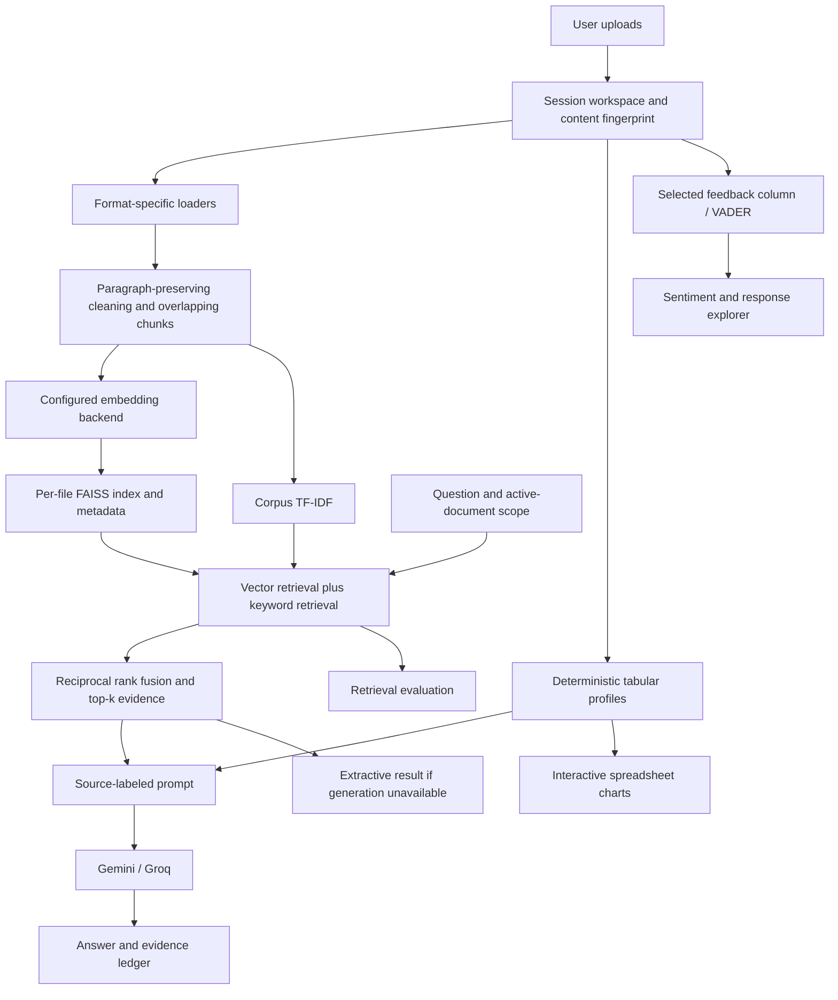

# Document Intelligence Workspace

## The 30-Second Pitch

> I built a document intelligence workspace that turns user-uploaded documents and spreadsheets into searchable evidence, interactive business analysis, and customer-feedback insights. It combines FAISS retrieval with TF-IDF ranking, grounds generated answers in labeled passages, and makes retrieval measurable through an evaluation interface and a separate metrics runner.

The app starts empty and uses only user uploads. There are no canned answers or bundled demonstration datasets. The automated tests use isolated fixtures, not application data.

## What Makes It Worth Discussing

| Capability | Implementation | What to show a recruiter |
| --- | --- | --- |
| Multi-format ingestion | PDF text extraction, DOCX paragraphs/tables, text/Markdown, CSV, XLS/XLSX sheets, JSON | Upload two different formats and inspect their evidence |
| Hybrid retrieval | FAISS vector ranking + corpus TF-IDF, combined with reciprocal rank fusion | Compare Vector and Hybrid in Retrieval lab |
| Traceable answers | Source IDs such as `[S1]` are included in the prompt and evidence ledger | Trace a factual statement back to the exact retrieved passage |
| Document scope | Explicit active-document selection; scope-specific conversation history | Switch to another document and show that earlier answers are no longer displayed |
| Spreadsheet exploration | Choose a sheet, measure, grouping, aggregation, and chart type | Change sum to mean and explain how the business question changes |
| Feedback intelligence | VADER scores each selected response row; searchable sentiment results | Select the actual feedback column, filter negative replies, export scored rows |
| Data quality | Missing cells, duplicates, summary statistics, correlation pairs, IQR outliers | Explain a data-quality problem before interpreting a chart |
| Measurable retrieval | Precision@k, source recall@k, MRR; Vector vs Hybrid comparison | Label expected sources, run a comparison, download the results |
| Failure handling | Gemini then Groq when configured; explicit extractive fallback | Explain how the system behaves if a provider is unavailable |
| Usable outputs | Persistent answers, Markdown evidence report, grouped CSV, feedback CSV, evaluation JSON | Download an analysis that another person can inspect |

## Architecture



The primary entrypoint is `streamlit_app.py`. Both Streamlit Cloud and the Windows launcher open the same workspace. The reusable RAG modules also support the FastAPI service. The older `ui/app.py` remains an API-client example, not the primary feature-complete interface.

## Technical Decisions to Defend

### Retrieval Is Inspectable

- Hybrid mode combines independent vector and TF-IDF ranks with `sum(1 / (60 + rank))`.
- The evidence ledger exposes both ranks and the resulting ranking score.
- The default embedding backend is local hashing: lightweight and download-free, but lexical rather than semantic. Do not describe it as a pretrained semantic model.
- `sentence-transformers` is an optional semantic backend. New indexes store backend/model metadata; retrieval uses the matching configuration instead of silently mixing incompatible embedding spaces.
- Hash-only matches need lexical support, reducing unrelated hits caused by hash collisions.
- This implementation does **not** include BM25, cross-encoder reranking, query rewriting, or a learned confidence estimator.

### Numbers Are Computed, Not Invented

Pandas calculates summaries and grouped chart data over the selected sheet. The LLM receives numeric profiles, including counts and sums, and is instructed not to invent whole-dataset totals from retrieved row fragments. The chart builder is deterministic: it does not execute model-generated Python or SQL.

Charts support bar, line, scatter, and distributions. Scatter plots use a reproducible 2,000-row sample when necessary; category charts display the top 30 groups. The data preview is capped at 500 rows. These display limits are disclosed in the UI; grouped calculations use the full sheet.

### Sentiment Is a Baseline, Not Mind Reading

VADER is a lexicon/rule-based English sentiment analyzer with negation and intensity handling. A selected spreadsheet row remains one response, even if it contains several sentences. Themes are keyword matches. Sentiment labels are useful screening signals, not verified customer intent; sarcasm, multilingual feedback, and specialized terminology need human review or a separately evaluated model.

### Honesty Makes the Demo Stronger

The old chunk-count-based "confidence" metric has been removed from the UI. The app reports evidence count and observed timing instead. Retrieved excerpts are labeled as extractive, not presented as successfully generated analysis. Citation prompting improves traceability but does not prove every generated claim is supported.

## Codebase Review

| Area | Main files | Review outcome |
| --- | --- | --- |
| Primary frontend | `streamlit_app.py`, `ui/workspace_app.py` | Four focused tabs, persistent answers, document scope, chart builder, feedback filters, exports |
| Upload lifecycle | `utils/workspace.py`, `embeddings/build_index_from_file.py` | Content-based fingerprints; format/size checks; workspace reset removes owned uploads and indexes |
| Parsing/chunking | `utils/file_loader.py`, `utils/text_cleaner.py`, `utils/text_splitter.py` | Supported formats preserved; paragraph boundaries retained; invalid chunk parameters rejected |
| Retrieval | `rag/retriever.py`, `embeddings/embedding_backend.py` | Hybrid ranking and index/model consistency; legacy metadata-free indexes require rebuilding |
| Generation | `rag/rag_pipeline.py`, `rag/web_search.py` | Labeled sources in prompts, scope-specific history, bounded provider calls, fallback after empty/error responses, no-context guard |
| Analytics | `utils/tabular_analyzer.py`, `utils/text_analytics.py` | All-null numeric fields handled; correlation duplicates removed; row-level sentiment and exportable results |
| API | `api/main.py`, `api/routes.py`, `api/schemas.py` | Request constraints, required session ID for uploads, file limits, meaningful HTTP error statuses |
| Evaluation | `evaluation/evaluate_rag.py` | Retrieval-only option, explicit retrieval mode, generated-only grounding proxy, independent evaluation sessions |
| Runtime | `run_app.ps1`, `scripts/run_demo.py`, `requirements.txt` | Primary workspace used locally and in cloud; dependency manifest consolidated |
| Regression tests | `tests/test_core.py` | Local fixtures and mocked providers; core behavior and Streamlit state interactions |
| Fine-tuning experiment | `finetuning/`, `models/finetuned_model/` | Separate FLAN-T5 LoRA experiment; not part of live answer generation and not evidence of production model quality |
| Legacy examples | `embeddings/build_embeddings.py`, root `test_*.py`, `embeddings/test_llm.py`, `ui/test_llm.py` | Older manual scripts, some tied to a particular PDF/index or live credentials; not the automated regression suite |
| Portfolio page | `docs/index.html` | Static presentation only; cannot host the Python application |

## Five-Minute Recruiter Walkthrough

1. **Problem, 30 seconds:** Teams have knowledge in incompatible document and spreadsheet formats. Answers must be inspectable, and numeric claims should use real calculations.
2. **Evidence, 90 seconds:** Upload a document you are authorized to share. Ask a question with a known answer. Expand the ledger and check the source passage; download the report.
3. **Analysis, 60 seconds:** Upload your spreadsheet, choose the sheet, and compare sums or means across a meaningful category. Inspect missing values before explaining the chart.
4. **Feedback, 60 seconds:** Choose a real feedback column. Analyze it, inspect negative examples, and explain the method's limitations rather than claiming perfect emotion detection.
5. **Engineering, 60 seconds:** Run a labeled retrieval comparison. Explain source recall versus answer correctness, provider fallback, embedding choices, and what remains before production deployment.

Use non-sensitive files you understand. Prepare known questions and expected answers before the interview. Keep evidence-only mode available for a network outage; it is explicitly not generative answering.

## Verification and Evaluation

```powershell
# Regression tests, no external LLM requests
.\.venv\Scripts\python.exe -m unittest discover -s tests -v

# Use your own labeled questions and freshly built index directories
python -m evaluation.evaluate_rag --dataset evaluation/sample_eval_dataset.json --index-dir data/indices/YOUR_INDEX --top-k 5 --retrieval-mode hybrid --retrieval-only
```

Replace the sample dataset's source names with your own uploaded filenames before evaluating. Precision@k divides relevant returned chunks by the requested k; source recall counts distinct expected documents found; MRR measures the first relevant source's rank. These use document-level labels, not fine-grained passage judgments. The lexical grounding proxy is not factuality or entailment, and is omitted for extractive fallback answers. Report measured results with the dataset and configuration; do not invent performance numbers.

## Honest Production Boundaries

- Sessions/indexes are local and process-based, without account authentication, durable jobs, or multi-worker coordination. Session IDs are not authorization. Do not expose the API as a multi-tenant service without access controls.
- Explicit clearing removes the current Streamlit workspace files, but abandoned browser sessions and API uploads still need scheduled retention cleanup.
- PDF support extracts embedded text; scanned-image OCR is not implemented. Very large or compressed workbooks require stronger resource limits than the current 20 MB/file and 10-document UI limits.
- Pickled indexes/profiles are generated internally. Never load untrusted external pickle files.
- External answer generation sends selected passages and numeric profiles to the configured provider. Optional web search sends the question to a third-party service. Use approved data only.
- Model availability, quotas, and credentials can still cause provider failures. No cloud generation success is claimed solely from local tests.
- Package versions are not fully locked. A production release needs a pinned, tested environment and deployment monitoring.
- Prompt instructions reduce injection risk but are not a complete security boundary.

## Resume Bullets

- Built a multi-format document intelligence workspace with reusable FastAPI endpoints, a Streamlit interface, FAISS indexing, and source-labeled RAG answers.
- Implemented hybrid vector/TF-IDF retrieval with reciprocal rank fusion, document-scoped conversations, and source-level retrieval evaluation.
- Added interactive spreadsheet exploration and row-level customer-feedback sentiment analysis with downloadable evidence and analysis reports.
- Added automated regression coverage for provider fallback, retrieval scope, request validation, numeric edge cases, and Streamlit rerun persistence.

Avoid claims such as "enterprise-ready", "99% accurate", "eliminates hallucinations", or "outperforms commercial products" without a suitable benchmark and security review.

## Reference Implementations

- [Streamlit app testing](https://docs.streamlit.io/develop/api-reference/app-testing/st.testing.v1.apptest)
- [scikit-learn TF-IDF](https://scikit-learn.org/stable/modules/generated/sklearn.feature_extraction.text.TfidfVectorizer.html)
- [VADER source and method](https://github.com/cjhutto/vaderSentiment)
